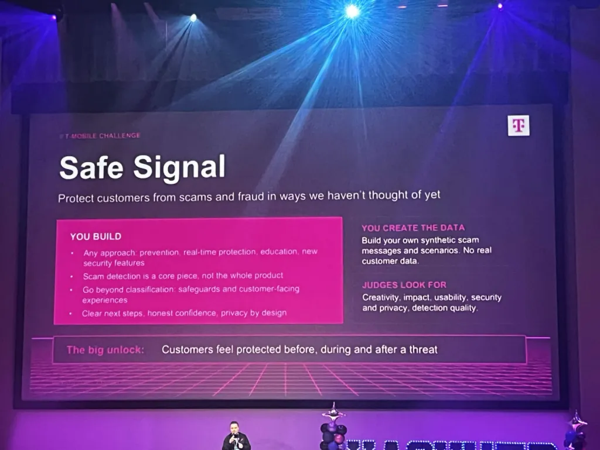
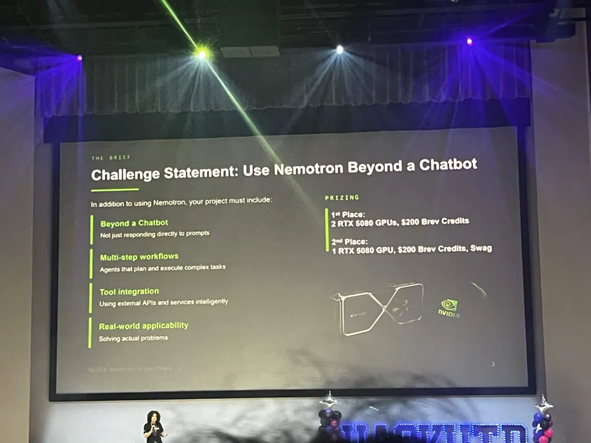

# HackUTD 2026 Challenge Briefs: T-Mobile and NVIDIA

Transcribed from the slides shown at the opening ceremony, Sat Nov 7, 2026. Photos are in `challenge_brief_photos/`.

---

## T-Mobile Challenge: Safe Signal

**Protect customers from scams and fraud in ways we haven't thought of yet.**

### You build
- Any approach: prevention, real-time protection, education, new security features
- Scam detection is a core piece, not the whole product
- Go beyond classification: safeguards and customer-facing experiences
- Clear next steps, honest confidence, privacy by design

### You create the data
Build your own synthetic scam messages and scenarios. No real customer data.

### Judges look for
Creativity, impact, usability, security and privacy, detection quality.

### The big unlock
Customers feel protected **before, during and after** a threat.

---

## NVIDIA Challenge: Use Nemotron Beyond a Chatbot

In addition to using Nemotron, your project must include:

| Requirement | What it means |
|---|---|
| **Beyond a Chatbot** | Not just responding directly to prompts |
| **Multi-step workflows** | Agents that plan and execute complex tasks |
| **Tool integration** | Using external APIs and services intelligently |
| **Real-world applicability** | Solving actual problems |

### Prizes
- **1st place:** 2 RTX 5080 GPUs, $200 Brev credits
- **2nd place:** 1 RTX 5080 GPU, $200 Brev credits, swag

---

## Not shown on the slides (ask the booths)
- T-Mobile prize amounts and number of winners
- Whether T-Mobile provides a sandbox, synthetic data or DevEdge API access (T-Mobile handed out synthetic data at DubHacks '26)
- NVIDIA: required model or endpoint, credits or higher rate limits for teams
